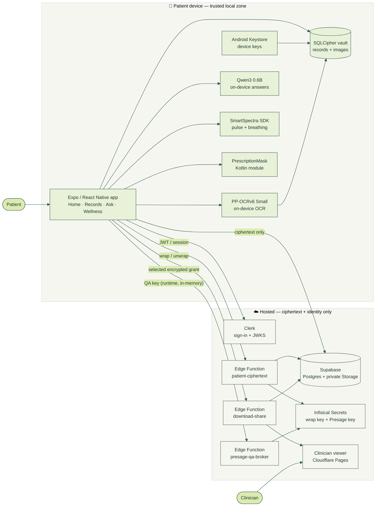

# Zoe

Zoe is an Android-first, patient-controlled health-history app built for the [Presage SmartSpectra SDK Challenge](https://dev.to/challenges/presage-2026-11-04). A patient keeps reviewed records, asks sourced questions about records, medicines, and meals, sees optional live wellness readings, and can share selected encrypted records with a clinician through a small web viewer.

> **Status:** implementation is in progress. Readable records, OCR text, prompts, and camera frames stay on the device. Only ciphertext and minimal metadata leave it. This is a synthetic-data hackathon build, not a clinically validated app.

---

## Architecture at a glance

Solid arrows are encrypted/authenticated calls. Dashed arrows are device-local only. Nothing crossing the device boundary is readable health data.



### Privacy promise

| Zone | What lives there | Leaves device? |
| --- | --- | --- |
| Device | Readable records, OCR text, model prompts/outputs, camera frames, vault keys | No |
| Hosted | Opaque object IDs, wrapped file keys, Clerk subject, share metadata | Ciphertext/metadata only |
| Server secrets | Wrapping secret, Presage key, service-role credential | Never reach the APK |

### Hosted storage write/read flow

```mermaid
sequenceDiagram
    participant App as Patient app
    participant EF as patient-ciphertext (Edge)
    participant Inf as Infisical
    participant DB as Supabase Postgres
    participant ST as Private Storage

    App->>App: Encrypt file with fresh random key (AES-GCM)
    App->>EF: wrap(objectId, rev, file key, ciphertext) + Clerk JWT
    EF->>EF: Verify JWT (JWKS) + owner check
    EF->>Inf: Fetch ZOE_WRAP_KEY_V1
    EF->>EF: Wrap file key (PBKDF2 → AES-GCM)
    EF->>ST: Store ciphertext (opaque path)
    EF->>DB: Store wrapped key + metadata
    EF-->>App: objectId + revision (no plaintext key retained)
    Note over App,ST: Storage sees only ciphertext; no medical text, filenames, or keys
```

---

## Repository

| Path | Purpose |
| --- | --- |
| `apps/mobile` | Expo SDK 58 / React Native patient app, with web preview for UI checks |
| `apps/clinician-web` | React + Vite clinician viewer for static hosting |
| `packages/records` | Record types, provenance, and local retrieval rules |
| `packages/nutrition` | Offline food matching and deterministic nutrient math |
| `packages/share-contract` | Versioned encrypted-share format and validation |
| `modules/*` | Kotlin Expo modules: SmartSpectra sensor, prescription mask, share crypto |
| `supabase/functions` | Edge Functions: `patient-ciphertext`, `presage-qa-broker`, `download-share` |
| `supabase/migrations` | Share grants, pairing codes, ciphertext bucket, ciphertext objects, QA allowlist |
| `tests/e2e-web` | Playwright browser flows |

The [MVP specification](MVP_SPEC.md) holds acceptance and safety gates. The [HTML proposal](proposal.html) shows the screen designs. Architecture decisions live in [ADR-001](docs/ADR-001-monorepo.md), [ADR-002 (patient storage)](docs/ADR-002-patient-storage.md), and [ADR-003 (credentials)](docs/ADR-003-mobile-credentials.md).

---

## Local setup

Requirements: Node.js and npm, JDK 17, Android SDK with platform/build tools and an emulator or phone. Custom native modules require a development or preview build; **Expo Go cannot load them**. Cloud features need a Supabase project with the reviewed migrations/functions and a Clerk project. The mobile app uses only **publishable** keys — a service-role or wrapping key must never enter a mobile or web bundle.

```bash
npm ci
npm run check
```

Browser UI preview:

```bash
cd apps/mobile
npx expo start --web
```

Local Android debug build (set `JAVA_HOME`, `ANDROID_HOME`, `ANDROID_SDK_ROOT` first):

```bash
cd apps/mobile
npx expo run:android
```

A debug APK loads JavaScript from Metro. To launch a previously built APK: `npx expo start --localhost --port 8081` from `apps/mobile`, then `adb reverse tcp:8081 tcp:8081` before opening it. A preview APK embeds the bundle and must be tested separately.

Clinician viewer:

```bash
cd apps/clinician-web
npm run dev
```

Public client config: `EXPO_PUBLIC_SUPABASE_URL`, `EXPO_PUBLIC_SUPABASE_PUBLISHABLE_KEY`, `EXPO_PUBLIC_CLINICIAN_VIEWER_URL`; viewer uses `VITE_SUPABASE_URL`, `VITE_SUPABASE_PUBLISHABLE_KEY`. Never commit `.env` files or privileged keys.

---

## Verification and limits

`npm run check` runs workspace type checks, unit tests, browser flows, and web builds. The local Android debug build compiles and installs on an API 34 emulator; it includes on-device OCR (PP-OCRv6 Small), Qwen3 lead-in answers, a SQLCipher vault, and the SmartSpectra module. Native model/sensor behavior and a bundled preview APK still need device verification.

Zoe answers medicine and nutrition questions with supported facts and explicit gaps. It must not diagnose, prescribe, choose a dose, or assert that a medicine is safe for a specific person. The hackathon build is for synthetic demonstration; real patient use needs clinical, privacy, security, and recovery review.
