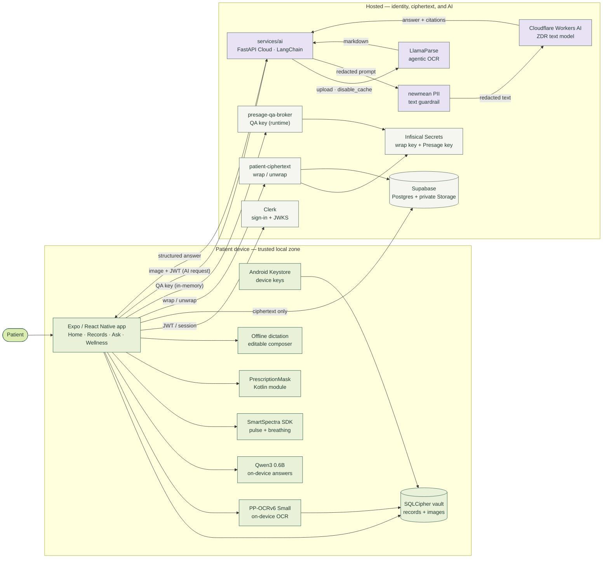
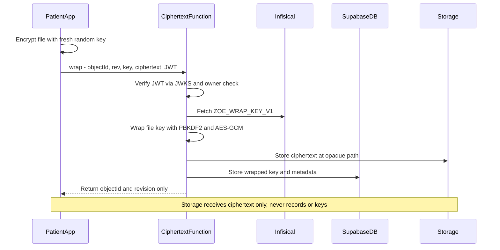
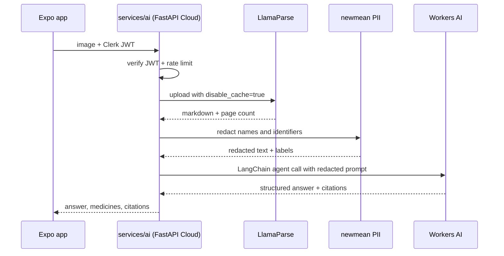

# Zoe

Zoe is an Android-first, patient-controlled health-history app built for the [Presage SmartSpectra SDK Challenge](https://dev.to/challenges/presage-2026-11-04). This patient release keeps reviewed records in a local encrypted vault, answers questions from confirmed records and a synthetic nutrition catalog, supports editable offline dictation, and provides an optional front-camera wellness check.

> **Status:** implementation remains in progress. Use synthetic data only. Zoe is not a diagnostic, prescribing, treatment, or emergency tool. Records and the vault stay on device. Prescription images and redacted text may be sent to hosted OCR/AI services during an explicit AI request; see the privacy boundary below.

---

## Architecture at a glance

Solid arrows are authenticated calls. Dashed arrows are device-local only. The device keeps readable records; hosted AI receives a prescription image and PII-redacted text only when the patient asks for an AI answer.



### Privacy promise

| Zone | What lives there | Leaves device? |
| --- | --- | --- |
| Device | Readable records, local OCR text, local prompts/outputs, camera frames, vault keys | No, except an explicit AI request |
| Hosted storage/identity | Opaque object IDs, wrapped file keys, Clerk subject | Ciphertext/metadata only |
| Hosted AI (on request) | Prescription image, PII-redacted text, question | Yes, to `services/ai`, LlamaParse, and Workers AI |
| Server secrets | Wrapping secret, Presage key, API keys, service-role credential | Never reach the APK |

The AI path is a hackathon trade-off: LlamaParse reads the raw image, and the newmean NER guardrail reduces (does not guarantee) what the LLM sees. Use synthetic data. See [services/ai/design.md](services/ai/design.md).

### Encrypted cloud storage flow



### AI request flow



Full decisions and reasons live in [services/ai/design.md](services/ai/design.md).

---

## Repository

| Path | Purpose |
| --- | --- |
| `apps/mobile` | Expo SDK 58 / React Native patient app for Android, with web preview for UI checks |
| `packages/records` | Record types, provenance, and local retrieval rules |
| `packages/nutrition` | Offline food matching and deterministic nutrient math |
| `modules/presage-sensor` | SmartSpectra Android bridge; fails closed without secure build configuration |
| `modules/share-crypto` | Android vault-key derivation used by the SQLCipher vault |
| `modules/prescription-mask` | Native prescription-image masking and RGB decode boundary |
| `services/ai` | FastAPI Cloud AI service: LlamaParse OCR, newmean PII, LangChain, Workers AI |
| `.github/workflows/deploy-ai.yml` | Test, prefetch PII model, and deploy `services/ai` on `main` |
| `tests/e2e-web` | Patient-only Firefox preview flows |

The [MVP specification](MVP_SPEC.md) holds the acceptance and safety gates.

---

## Local setup

Requirements: Node.js and npm, JDK 17, and Android SDK platform/build tools. Custom native modules require a development or preview build; Expo Go cannot load them. Cloud features need a Supabase project with the reviewed migrations/functions and a Clerk project. The app uses only **publishable** keys — a service-role or wrapping key must never enter a bundle.

```bash
npm ci
npm run check
```

Run patient UI preview with synthetic browser storage:

```bash
cd apps/mobile
npx expo start --web
```

The preview opens through **Unlock synthetic preview**. It contains only synthetic records. Browser storage is not SQLCipher and does not prove Android vault behavior.

Patient email OTP sign-in uses `EXPO_PUBLIC_SUPABASE_URL` and `EXPO_PUBLIC_SUPABASE_PUBLISHABLE_KEY`. Signed-in account identifiers remain internal vault namespaces and are not shown in patient-facing copy.

### AI service

The AI service is a separate uv project. Python 3.12 or 3.13 is required.

```bash
cd services/ai
uv sync
uv run pytest -q
uv run fastapi dev app/main.py
```

Set these environment variables before running it (or use `fastapi cloud env set` for the deployed app):

| Variable | Purpose |
| --- | --- |
| `LLAMA_CLOUD_API_KEY` | LlamaParse uploads and parsing |
| `CF_ACCOUNT_ID`, `CF_AI_TOKEN` | Cloudflare Workers AI endpoint and API token |
| `CF_MODEL` | Model ID; default `@cf/meta/llama-3.3-70b-instruct-fp8-fast` |
| `CLERK_JWKS_URL`, `CLERK_ISSUER`, `CLERK_AUDIENCE` | Clerk JWT verification |
| `AUTH_ENABLED=false` | Local development only; bypasses Clerk with `X-Zoe-Subject` |
| `PII_SIZE`, `PII_MODEL_DIR`, `NEWMEAN_PII_CACHE` | PII model selection and prefetch |
| `LLAMAPARSE_TIER`, `LLAMAPARSE_VERSION` | Parsing tier and version |
| `RATE_LIMIT_PER_MINUTE`, `MAX_UPLOAD_MB` | Request limits |

Endpoints: `GET /health`, `POST /parse` (image upload), `POST /ask` (question plus optional image or already-redacted text). All require a bearer JWT unless `AUTH_ENABLED=false`.

Pushes to `main` touching `services/ai` run `.github/workflows/deploy-ai.yml`: locked dependency install, tests, PII model prefetch, then `fastapi cloud deploy`. GitHub Secrets needed: `FASTAPI_CLOUD_TOKEN`, `FASTAPI_CLOUD_APP_ID`.

## Android builds

For a local debug build, set `JAVA_HOME`, `ANDROID_HOME`, and `ANDROID_SDK_ROOT`, then run:

```bash
cd apps/mobile
npx expo run:android
```

A debug APK loads JavaScript from Metro. A standalone preview APK embeds its JavaScript bundle:

```bash
cd apps/mobile
npx eas-cli build --platform android --profile preview
```

`apps/mobile/eas.json` keeps preview output as an installable APK. Presage credentials come from secure build input or the runtime QA broker; no reusable key belongs in source, `.env`, logs, or a shared APK.

SmartSpectra stays on the native `modules/presage-sensor` bridge. The Expo app reports it as available only on Android when a secure build key or a valid runtime QA-broker key is present; otherwise it fails closed and the wellness screen explains why. Web preview never claims SmartSpectra support.

## Verification and limits

`npm run check` runs workspace type checks, unit tests, patient Firefox flows, and web builds. `cd services/ai && uv run pytest -q` runs the AI service tests with mocked OCR/LLM calls. Native correctness requires a separate Android build and device test. Web tests do not prove SQLCipher, Keystore, offline speech, camera behavior, SmartSpectra capture, or absence of network traffic.

Zoe shows provenance and uncertainty, rejects unconfirmed records at safety boundaries, and does not invent sensor values. Real patient use needs separate clinical, privacy, security, recovery, accessibility, and device validation.
