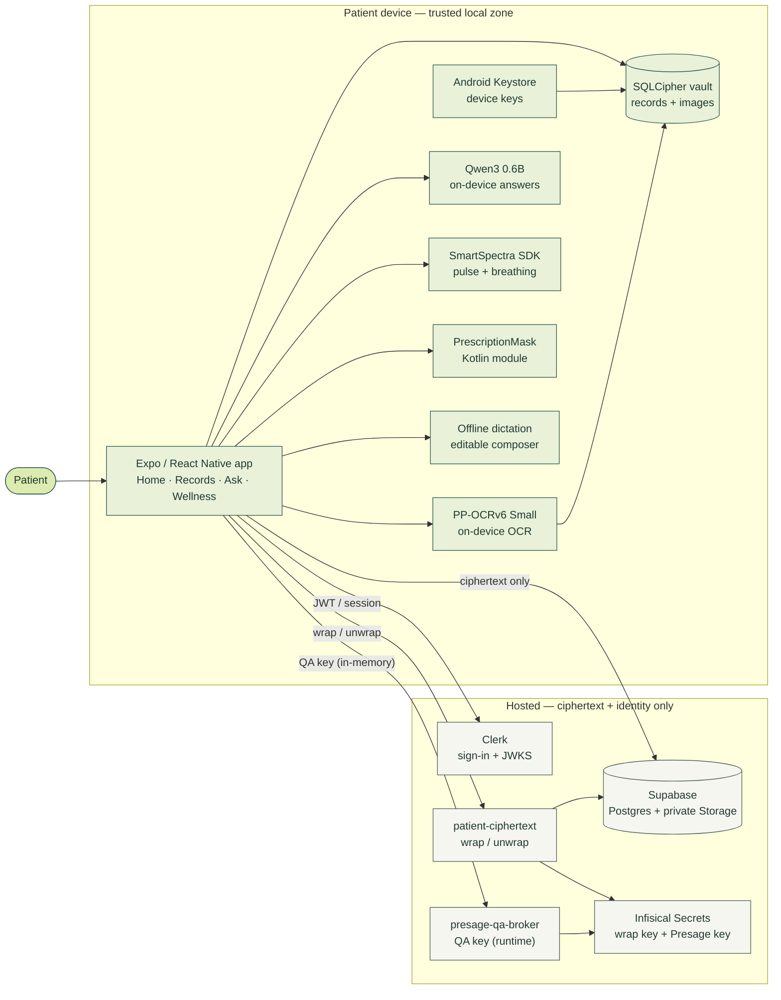
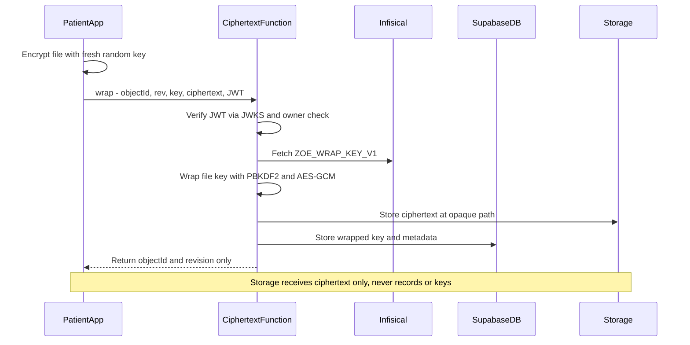

# Zoe

Zoe is an Android-first, patient-controlled health-history app built for the [Presage SmartSpectra SDK Challenge](https://dev.to/challenges/presage-2026-11-04). This patient release keeps reviewed records in a local encrypted vault, answers questions from confirmed records and a synthetic nutrition catalog, supports editable offline dictation, and provides an optional front-camera wellness check.

> **Status:** implementation remains in progress. Use synthetic data only. Zoe is not a diagnostic, prescribing, treatment, or emergency tool. Readable records, OCR text, prompts, and camera frames stay on the device; only ciphertext and minimal metadata reach hosted services.

---

## Architecture at a glance

Solid arrows are encrypted/authenticated calls. Dashed arrows are device-local only. Nothing crossing the device boundary is readable health data.



### Privacy promise

| Zone | What lives there | Leaves device? |
| --- | --- | --- |
| Device | Readable records, OCR text, model prompts/outputs, camera frames, vault keys | No |
| Hosted | Opaque object IDs, wrapped file keys, Clerk subject, share metadata | Ciphertext/metadata only |
| Server secrets | Wrapping secret, Presage key, service-role credential | Never reach the APK |

### Encrypted cloud storage flow



---

## Repository

| Path | Purpose |
| --- | --- |
| `apps/mobile` | Expo SDK 58 / React Native patient app for Android, with web preview for UI checks |
| `packages/records` | Record types, provenance, and local retrieval rules |
| `packages/nutrition` | Offline food matching and deterministic nutrient math |
| `modules/presage-sensor` | SmartSpectra Android bridge; fails closed without secure build configuration |
| `modules/share-crypto` | Android vault-key derivation used by the SQLCipher vault |
| `modules/prescription-mask` | Native prescription-image masking and RGB decode boundary |
| `tests/e2e-web` | Patient-only Firefox preview flows |

The [MVP specification](MVP_SPEC.md) holds the acceptance and safety gates.

---

## Local setup

Requirements: Node.js and npm, JDK 17, and Android SDK platform/build tools. Custom native modules require a development or preview build; Expo Go cannot load them. Cloud features need a Supabase project with the reviewed migrations/functions and a Clerk project. The app uses only **publishable** keys — a service-role or wrapping key must never enter a bundle.

```bash
npm ci
npm run check
```

Run patient UI preview with synthetic browser storage:

```bash
cd apps/mobile
npx expo start --web
```

The preview opens through **Unlock synthetic preview**. It contains only synthetic records. Browser storage is not SQLCipher and does not prove Android vault behavior.

Patient email OTP sign-in uses `EXPO_PUBLIC_SUPABASE_URL` and `EXPO_PUBLIC_SUPABASE_PUBLISHABLE_KEY`. Signed-in account identifiers remain internal vault namespaces and are not shown in patient-facing copy.

## Android builds

For a local debug build, set `JAVA_HOME`, `ANDROID_HOME`, and `ANDROID_SDK_ROOT`, then run:

```bash
cd apps/mobile
npx expo run:android
```

A debug APK loads JavaScript from Metro. A standalone preview APK embeds its JavaScript bundle:

```bash
cd apps/mobile
npx eas-cli build --platform android --profile preview
```

`apps/mobile/eas.json` keeps preview output as an installable APK. Presage credentials come from secure build input or the runtime QA broker; no reusable key belongs in source, `.env`, logs, or a shared APK.

## Verification and limits

`npm run check` runs workspace type checks, unit tests, patient Firefox flows, and web builds. Native correctness requires a separate Android build and device test. Web tests do not prove SQLCipher, Keystore, offline speech, camera behavior, or absence of network traffic.

Zoe shows provenance and uncertainty, rejects unconfirmed records at safety boundaries, and does not invent sensor values. Real patient use needs separate clinical, privacy, security, recovery, accessibility, and device validation.
