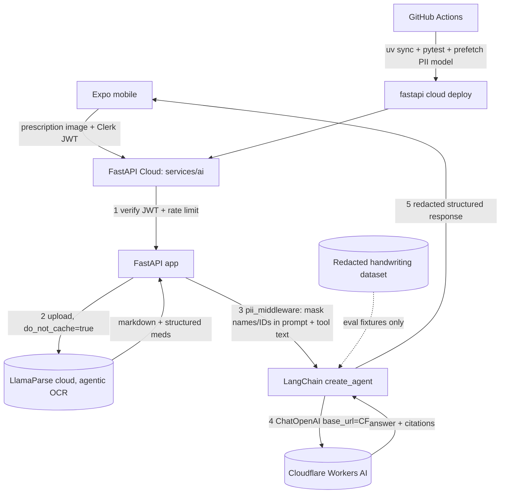

# Zoe AI service — architecture design

Status: proposed, not implemented. Owner approved research + this design on 2026-11-24.
Branch: `main` (patient-only). Clinician sharing is a later concern on `clinician-sharing`.
Scope: hackathon MVP. Working implementation matters more than production hardening.

Note on filename: the repository already has `docs/design.md` for UI design tokens. This document lives with the new package at `services/ai/design.md` to avoid overwriting it.

## 1. Goal

Replace the abandoned idea of reinventing OCR/PII logic with a small, modern stack:

- OCR: LlamaParse cloud (handwriting on prescriptions).
- PII: newmean NER as a guardrail on text sent to the LLM.
- Agent/runtime: LangChain in a FastAPI Cloud Python service.
- LLM: Cloudflare Workers AI (no Gemini API key).
- Client: Expo mobile unchanged.
- Eval corpus: the downloaded, already-redacted handwriting dataset.

Non-goals: local OCR deployment, image de-identification pipeline, HIPAA/BAA production posture, clinician features, published-history rewrite.

## 2. Architecture

## 3. Components

| Slot | Tech | Notes |
| --- | --- | --- |
| Mobile | Expo | Camera, records, Wellness. No OCR stack change planned. |
| AI service | FastAPI Cloud `services/ai` | New uv-managed Python package. `app/{main,auth,ocr,pii,agent,providers,schemas}.py`, `tests/`. |
| Auth | Clerk JWT | Verify at FastAPI boundary; per-user rate limit. |
| OCR | LlamaParse cloud, `agentic` tier | `do_not_cache=true`; handwriting comes from OCRia-1 inside LlamaParse. No local OCR. |
| PII | `newmean-pii[langchain]`, size medium or large | `pii_middleware` masks user message and tool-result text. `allow` list keeps medicine terms. Model prefetched at build. |
| Agent | LangChain `create_agent` + `response_format=Pydantic` | Base agent, not Deep Agents. Stateless or `InMemorySaver`; no persisted PHI. |
| LLM | Cloudflare Workers AI via `ChatOpenAI` | `base_url=https://api.cloudflare.com/client/v4/accounts/{CF_ACCOUNT_ID}/ai/v1`. Model `@cf/meta/llama-3.3-70b-instruct-fp8-fast` (function calling, zero data retention) or `@cf/zhipu-ai/glm-4.7-flash` (131k context, multilingual). Uses Cloudflare token, not Gemini key. |
| Eval corpus | Downloaded redacted handwriting dataset | Fixtures/tests only, never live input. |
| Backend | Existing Supabase Edge Functions | Ciphertext bucket + `presage-qa-broker` unchanged. |
| CI/CD | GitHub Actions → `fastapi cloud deploy` | Secrets: `FASTAPI_CLOUD_TOKEN`, `FASTAPI_CLOUD_APP_ID`, `LLAMA_CLOUD_API_KEY`, `CF_ACCOUNT_ID`, `CF_AI_TOKEN`. |
| Deploy | FastAPI Cloud CLI | Cloud builds from `uv.lock`; CI prefetches PII model into the deploy directory. `--large-file-threshold 101` for 11–16 MB model files. |

## 4. Request sequence

1. Expo POSTs `/parse` and `/ask` with the image plus Clerk JWT.
2. FastAPI verifies JWT and applies rate limit.
3. Image uploads to LlamaParse with `do_not_cache=true`; result is markdown plus structured medicine fields.
4. `pii_middleware` redacts patient names and identifiers in messages and tool results; `allow` list preserves medicine/dosage terms.
5. LangChain agent calls Workers AI through `ChatOpenAI` with the redacted prompt.
6. Structured answer with citations returned to Expo. Logs contain no image, raw text, or PHI.
7. No checkpointer state persisted across users.

## 5. Decisions and reasons

| # | Decision | Reason |
| --- | --- | --- |
| D1 | LlamaParse cloud is the only OCR path | Prescription handwriting is the hard case; OCRia-1 (4B VLM) lives inside LlamaParse. Local OCRia-nano is 8.1M params, cannot read handwriting, and would add 60–75 MB of models + ONNX Runtime for no benefit on the target input. |
| D2 | Use the downloaded redacted dataset as eval fixtures | Already redacted, contains medicine handwriting only. Removes the need to handle real patient PII during development. Confirm dataset terms before any distribution. |
| D3 | newmean NER guards conversation text, not images | The model detects text spans. It cannot strip identifiers from pixels. Applied as LangChain middleware it reliably masks names/IDs in prompts and tool results before any LLM sees them. |
| D4 | One FastAPI Cloud service, new package `services/ai` | Separate from the Expo app and existing Supabase functions. Keeps patient-only boundary on `main`; clinician code never enters this package. |
| D5 | LangChain `create_agent` with structured output | Small, narrow task. Base agent is lighter than the Deep Agents harness. `response_format` gives validated answer + citations. |
| D6 | Cloudflare Workers AI replaces Gemini | OpenAI-compatible `/ai/v1/chat/completions` endpoint works with `ChatOpenAI(base_url=...)`. 10,000 Neurons/day free on Workers Free, 300 req/min text generation, no extra Gemini key. Selected model advertises zero data retention. |
| D7 | GitHub Actions builds and deploys | CI runs `uv sync --locked`, `pytest` against the redacted fixtures, prefetches the PII model, then calls `fastapi cloud deploy`. FastAPI Cloud builds remotely from `uv.lock`; the prefetched model ships in the deploy directory. |
| D8 | Keep `presage-qa-broker` on Supabase | It already works and is not an LLM backend. No migration in MVP. |
| D9 | Stateless / in-memory agent state | Reduces PHI persistence. Only model-bound copies are masked by the middleware; original messages stay in agent state, so persisting checkpoints would store PHI. |
| D10 | `do_not_cache=true` on LlamaParse | Avoids the default 48-hour source-file cache. |

## 6. Dropped from earlier plans

| Earlier idea | Why dropped |
| --- | --- |
| LiteParse + OCRia-nano local OCR | Weak on handwriting; extra runtime/deps for no target benefit. |
| OCRia-1 self-hosted | 4B VLM needs GPU/vLLM; FastAPI Cloud offers no GPU. Use it through LlamaParse. |
| Local image de-identification then cloud OCR | NER misses 4.9–21.4% on external sets, OCR errors shift offsets, and non-text identifiers are invisible. Dataset is already redacted for dev. |
| Gemini API key | Replaced by Workers AI (D6). |
| Worker/cloud build artifact upload | FastAPI Cloud deploys from source + `uv.lock`; CI bundles models and invokes CLI. |

## 7. Deferred implementation notes

- `pii_middleware(size="medium", strategy="redact", apply_to_input=True, apply_to_output=True, apply_to_tool_results=True)`; tune size with an eval set.
- `pii_detector` for masking any logs/traces. `info()` records package/model version + SHA-256 for audit.
- Prefetch: `NEWMEAN_PII_CACHE=./models python -m newmean_pii download --size medium`.
- Cloudflare endpoint verified through MCP: `https://api.cloudflare.com/client/v4/accounts/{account_id}/ai/v1/chat/completions`; LangChain documents `ChatOpenAI` with custom `base_url` for OpenAI-compatible providers.
- FastAPI Cloud instances: Nano 0.1 CPU / 500 MiB (Hobby); Small 1 CPU / 2 GiB (Pro). Start Nano for demo, move to Small if OCR/PII latency is high. No GPU available.
- Workflow can be bootstrapped from `fastapi cloud ci print-workflow` (read-only) rather than hand-written.

## 8. Privacy and compliance posture (hackathon-accepted)

- LlamaParse sees raw images; account is in the data-sharing program. Dev uses redacted fixtures. Live uploads need explicit user consent.
- LlamaParse: SOC 2 Type II, no training by default except opt-in program, 48 h cache (disabled here), AES-256 at rest, TLS 1.2+, no BYOK. HIPAA pipeline + BAA is Enterprise only.
- Workers AI chosen model advertises zero data retention.
- PII guardrail reduces what providers see; it is not a guarantee.
- FastAPI Cloud has no published BAA. This architecture is not production-ready for PHI.

## 9. Open items before build

1. Smoke-test one `ChatOpenAI` call through Workers AI with function calling / structured output.
2. Confirm Neurons-per-request for the chosen model against the 10k/day free allocation.
3. Confirm `fastapi cloud deploy` accepts the prefetched PII model directory within upload limits.
4. Build a redaction eval set: zero target-PII leaks, >=95% medicine-field retention.
5. Confirm dataset license/terms for hackathon use and any demo distribution.

## 10. Sources

- newmean-pii: https://github.com/newmean-ai/pii (JS/README.md, Python/README.md, HF model card)
- LangChain middleware / structured output / custom URLs: https://docs.langchain.com
- LiteParse + OCRia-nano: https://developers.llamaindex.ai/liteparse/, https://huggingface.co/llamaindex/OCRia-nano-1
- OCRia-1: https://huggingface.co/llamaindex/OCRia-1
- LlamaParse privacy/retention/compliance: https://developers.llamaindex.ai/llamaparse/general/
- FastAPI Cloud instance sizes and deploy CLI: https://fastapicloud.com/docs/
- Cloudflare Workers AI pricing, limits, OpenAI compatibility: https://developers.cloudflare.com/workers-ai/
